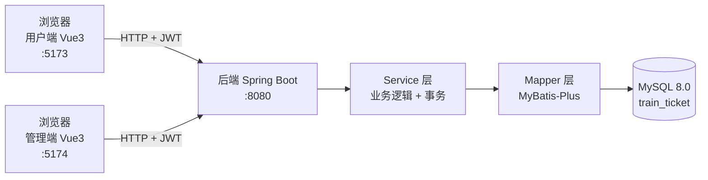

# 01 · 项目结构设计

> 这份文档回答三个问题：这个项目要做成什么样、代码分几个工程、每个文件都放什么。

---

## 一、先把需求翻译成功能清单

拿到「做一个 12306」这种模糊需求，第一步不是写代码，而是把它拆成**能一个个勾掉的功能点**。

### 用户端

| 模块 | 功能点 |
| --- | --- |
| 账号 | 注册、登录、退出、改昵称/密码 |
| 查票 | 输入出发站、到达站、日期 → 车次列表（时刻、历时、各席别余票和价格） |
| 车次详情 | 点开车次看经停站和每段票价 |
| 乘车人 | 常用乘车人增删改查 |
| 下单 | 选乘车人 → 确认订单 → 提交 → 模拟支付 |
| 订单 | 我的订单列表、订单详情、取消订单、退票 |

### 管理端（服务端）

| 模块 | 功能点 |
| --- | --- |
| 账号 | 管理员登录、退出 |
| 车站管理 | 增删改查、启用停用、按拼音搜索 |
| 车次管理 | 增删改查车次 |
| 停站管理 | 给车次配置停站顺序、时刻、里程（**这一步决定分段**） |
| 票价管理 | 配置每段每席别的价格 |
| 库存管理 | 为指定日期批量生成库存、手动调整余票、查看某天某车次的逐段余票 |
| 订单管理 | 全部订单查询、订单详情、代客退票 |
| 数据统计 | 今日订单量/销售额、热门线路 Top、各车次上座率 |

### 第一阶段明确不做（写进 README，防止自己跑偏）

- Redis、消息队列、微服务、分库分表
- 真实支付对接（用一个「模拟支付」按钮代替）
- 选座、改签、候补、学生票优惠计算

---

## 二、技术选型

| 层次 | 选型 | 为什么 |
| --- | --- | --- |
| 前端框架 | Vue 3 + Vite | 上手快、中文资料多；两个端共用一套技术栈，学一次用两遍 |
| UI 组件 | Element Plus | 表格、表单、日期选择器开箱即用，不用手写样式 |
| 前端状态 | Pinia | 存登录用户、token |
| 前端路由 | Vue Router | 顺带练路由守卫（未登录跳登录页） |
| 请求 | Axios | 统一封装拦截器：自动带 token、统一处理 401 |
| 后端语言 | Java 17 | 校招/实习最主流，Spring 生态成熟 |
| 后端框架 | Spring Boot 3.x | 自动配置、内置 Tomcat，起步成本低 |
| 持久层 | MyBatis-Plus | 单表 CRUD 不用写 SQL；复杂查询手写 XML，两种都能练到 |
| 数据库 | MySQL 8.0 | 支持窗口函数、CHECK 约束，够用且通用 |
| 鉴权 | JWT | 无状态，前后端分离标配；前期手写拦截器比直接上 Spring Security 更好理解 |
| 接口文档 | Knife4j（OpenAPI 3） | 写接口自动出文档，前端照着文档对接 |
| 构建 | Maven / npm | 最主流，资料最多 |

**为什么不用 Node 或 Python 写后端？**
Node（NestJS）和 Python（FastAPI）都能做，甚至起步更快，但 Java + Spring Boot 是国内招聘市场上
最吃这套经验的组合，而且这个项目后面要讲事务、行锁、并发扣减，Java 生态的示例最多。

---

## 三、整体架构



一次「查询车票」的请求链路：

1. 用户端页面输入「北京南 / 上海虹桥 / 2026-10-15」，点查询
2. Axios 发 `GET /api/user/tickets?from=1&to=5&date=2026-10-15`，请求头带 `Authorization: Bearer <token>`
3. 后端 `JwtInterceptor` 校验 token，把 `userId` 放进 `LoginUserContext`（ThreadLocal）
4. `TicketController` 收参数 → `TicketService` 处理业务
5. `TicketMapper` 执行 SQL：先查哪些车次同时停靠这两个站且顺序正确，再查 `ticket_stock` 取余票最小值
6. 返回统一格式 `R<List<TicketVO>>`，前端渲染列表

---

## 四、仓库目录结构

采用**单仓库多工程**（monorepo）：一个 Git 仓库里放三个可独立运行的工程，改后端和改前端同一个
commit 就能一起提交，对个人项目最省事。

```text
渐进式开发/
├── README.md                     项目总览、学习路线
├── docs/                         设计文档
│   ├── 01-项目结构设计.md
│   ├── 02-数据库设计.md
│   ├── 03-接口约定.md            （阶段 1 后补）
│   └── 04-开发日志.md            （每阶段记录踩的坑，面试时是加分项）
├── sql/
│   ├── 01-schema.sql             建库建表
│   └── 03-demo-data-large.sql    大规模演示数据
│
├── backend/                      后端工程（Spring Boot）
│   ├── pom.xml
│   └── src/main/
│       ├── java/com/ticket/
│       │   ├── TicketApplication.java        启动类
│       │   │
│       │   ├── common/                       全项目公共代码
│       │   │   ├── result/
│       │   │   │   ├── R.java                统一返回体 { code, msg, data }
│       │   │   │   ├── PageResult.java       统一分页返回
│       │   │   │   └── ResultCode.java       错误码枚举
│       │   │   ├── exception/
│       │   │   │   ├── BizException.java     业务异常（余额不足、票卖完了）
│       │   │   │   └── GlobalExceptionHandler.java  全局异常处理
│       │   │   ├── constant/                 常量（订单状态、席别等枚举）
│       │   │   └── util/                     工具类（订单号生成等）
│       │   │
│       │   ├── config/                       配置类
│       │   │   ├── MybatisPlusConfig.java    分页插件
│       │   │   ├── WebMvcConfig.java         注册拦截器、跨域
│       │   │   └── Knife4jConfig.java        接口文档
│       │   │
│       │   ├── security/                     鉴权
│       │   │   ├── JwtUtil.java              生成/解析 token
│       │   │   ├── JwtInterceptor.java       用户端拦截器
│       │   │   ├── AdminJwtInterceptor.java  管理端拦截器
│       │   │   └── LoginUserContext.java     当前登录人（ThreadLocal）
│       │   │
│       │   └── module/                       ★ 业务模块（按功能分包）
│       │       ├── auth/                     登录注册
│       │       ├── station/                  车站
│       │       ├── train/                    车次 + 停站 + 段 + 票价
│       │       ├── stock/                    库存生成与调整
│       │       ├── ticket/                   余票查询（用户端核心）
│       │       ├── order/                    下单、支付、取消、退票
│       │       ├── passenger/                乘车人
│       │       └── stats/                    后台统计
│       │
│       └── resources/
│           ├── application.yml               公共配置
│           ├── application-dev.yml           本地数据库账号密码
│           └── mapper/                       MyBatis XML（复杂 SQL 写这里）
│
├── frontend-user/                用户端（Vue 3）
│   ├── package.json
│   ├── vite.config.js
│   ├── .env.development          接口基地址
│   └── src/
│       ├── main.js
│       ├── App.vue
│       ├── api/                  每个模块一个文件，只放接口调用
│       │   ├── request.js        Axios 实例 + 拦截器
│       │   ├── auth.js
│       │   ├── ticket.js
│       │   └── order.js
│       ├── router/index.js       路由 + 登录守卫
│       ├── store/user.js         Pinia：token、用户信息
│       ├── views/                页面（一个页面对应一个文件）
│       │   ├── Login.vue
│       │   ├── Register.vue
│       │   ├── TicketSearch.vue  查询页（首页）
│       │   ├── TicketList.vue    车次列表
│       │   ├── OrderConfirm.vue  确认订单
│       │   ├── MyOrders.vue      我的订单
│       │   ├── OrderDetail.vue
│       │   └── Passenger.vue     常用乘车人
│       ├── components/           可复用组件（车次卡片、席别选择器等）
│       ├── utils/                日期格式化等
│       └── assets/
│
└── frontend-admin/               管理端（Vue 3）
    └── src/
        ├── api/  router/  store/  utils/     结构和用户端一致
        ├── layout/index.vue                  后台框架（左侧菜单 + 顶栏）
        └── views/
            ├── Login.vue
            ├── Dashboard.vue                 数据看板
            ├── station/StationList.vue
            ├── train/TrainList.vue
            ├── train/TrainStopEdit.vue       ★ 配置停站（决定分段）
            ├── stock/StockManage.vue         生成/调整库存
            ├── order/OrderList.vue
            └── system/AdminList.vue
```

### 分包策略：按业务分，不按层分

新手常见写法是 `controller/` 放所有 Controller、`service/` 放所有 Service，几十个文件堆在一起。
项目一大就找不到东西。**更好的做法是按业务模块分包**（上面 `module/` 的写法），每个模块自己带
`controller / service / mapper / entity / dto`：

```text
module/order/
├── OrderController.java      用户端下单、查订单
├── AdminOrderController.java 管理端订单管理
├── OrderService.java         接口
├── impl/OrderServiceImpl.java 实现（事务写在这层）
├── OrderMapper.java
├── entity/TicketOrder.java   和数据库表一一对应
├── dto/CreateOrderDTO.java   接收前端参数
└── vo/OrderVO.java           返回给前端的结构
```

一个模块要改，就只动这个目录，心里有边界。

---

## 五、后端一条完整链路（照着抄就行）

以「用户查询车票」为例，每个文件负责什么：

| 文件 | 职责 | 不该做的事 |
| --- | --- | --- |
| `TicketController` | 接收 HTTP 参数、校验、调用 Service、包装返回值 | 不写业务逻辑、不碰数据库 |
| `TicketService` | 业务逻辑、事务边界、组装 VO | 不拼 SQL、不关心 HTTP |
| `TicketMapper` / `TicketMapper.xml` | 只负责执行 SQL | 不写业务判断 |
| `entity/TicketStock` | 和表字段一一对应 | 不当作接口返回对象 |
| `dto/TicketQueryDTO` | 接收前端传参，加校验注解 | 不返回给前端 |
| `vo/TicketVO` | 专门给前端看的字段（含拼好的格式化时间） | 不和表结构强绑定 |

**为什么要区分 entity / dto / vo？** 因为表字段和接口字段的需求经常不一样：表里存 `status=1`，
前端要显示「已支付」；表里没有「历时」，前端要显示「5 小时 28 分」。把这些转换放在 Service 里做，
数据库结构就不会被接口需求牵着走。

---

## 六、接口约定

### 1. 统一返回格式

```json
{ "code": 200, "msg": "操作成功", "data": { } }
```

分页时 `data` 固定为：

```json
{ "total": 128, "pages": 7, "current": 1, "size": 20, "records": [ ] }
```

### 2. 错误码

| code | 含义 |
| --- | --- |
| 200 | 成功 |
| 400 | 参数校验失败 |
| 401 | 未登录 / token 过期 |
| 403 | 没有权限（普通用户访问管理端接口） |
| 500 | 服务器内部错误 |
| 1001 | 用户名已存在 |
| 1002 | 用户名或密码错误 |
| 2001 | 该车次该区间余票不足 |
| 2002 | 订单不存在或状态不允许此操作 |
| 2003 | 订单已超时 |

### 3. 路径规划：两个端各占一个前缀

| 前缀 | 使用者 | 拦截器 |
| --- | --- | --- |
| `/api/user/**` | 用户端（注册、登录、查票、下单） | `JwtInterceptor` |
| `/api/admin/**` | 管理端（登录、基础数据、订单管理） | `AdminJwtInterceptor` |
| `/api/public/**` | 不需要登录（如车站列表、验证码） | 放行 |

两个端各发各的 token，在 token 里塞 `role` 字段，拦截器按前缀校验角色。
这样「普通用户拿到 token 去调管理端接口」会被 403 挡住——这是最基础也最重要的一道安全线。

### 4. 命名

- 查询用 `GET`，新增 `POST`，修改 `PUT`，删除 `DELETE`
- 路径用复数名词：`/api/user/orders`、`/api/admin/stations`
- 时间统一传 `yyyy-MM-dd`（日期）和 `yyyy-MM-dd HH:mm:ss`（时刻）
- 金额统一用 `Decimal`，前端按两位小数展示

---

## 七、开发顺序

每个阶段都有可运行的产出，不要跳。

| 阶段 | 产出 | 涉及技术点 |
| --- | --- | --- |
| 0 | 需求清单、页面草图、MySQL 和 IDEA 装好 | 需求拆解、Git 提交规范 |
| 1 | 后端能启动，访问 `/api/public/ping` 返回统一 JSON | Spring Boot 分层、统一返回/异常、跨域、Knife4j |
| 2 | 两个端都能登录，登录后能拿到自己的信息 | JWT、密码加密、拦截器、Pinia、路由守卫 |
| 3 | 管理端能录车站 / 车次 / 停站 / 段票价 | 表关联、级联删除、事务、Element Plus 表单校验 |
| 4 | 能按日期生成库存，用户端能查到余票 | 分段库存模型、批量插入、区间最小值的 SQL |
| 5 | 用户能下单、支付、查订单、取消 | 事务、条件更新防超卖、订单状态机、ThreadLocal |
| 6 | 管理端能看订单和统计图表 | 多表聚合 SQL、ECharts |
| 7 | 两个端美化、联调、部署到服务器 | Nginx、前后端打包、跨域处理 |
| 8 | 用中间件优化 | Redis 缓存余票、分布式锁、MQ 削峰、分库分表 |

**每个阶段结束都要做一件事：写进 `docs/04-开发日志.md`。** 记录「遇到了什么问题、怎么查的、
最后怎么解决的」，这段文字在面试时比项目本身更能证明能力。

---

## 八、新手最容易踩的坑（提前打预防针）

1. **接口返回格式不统一** → 前端每个页面写一套解析逻辑。从阶段 1 就定死 `R<T>`。
2. **把密码明文存数据库** → 一律 BCrypt，登录时用 `matches()` 比较，不要解密。
3. **Controller 里写业务逻辑** → 后期加事务、加缓存时会很痛苦。
4. **前端直接调后端真实地址写死在代码里** → 用 `.env.development` 配置基地址。
5. **忘记处理跨域** → 开发期后端配 CORS，或前端 Vite 配 proxy。
6. **金额用 double** → 浮点误差会让 19.99 变成 19.989999。Java 用 `BigDecimal`，数据库用 `DECIMAL`。
7. **时间用字符串存** → 数据库用 `DATE` / `DATETIME`，Java 用 `LocalDate` / `LocalDateTime`。
8. **先做完再提交 Git** → 每个小功能一个 commit，提交信息写清楚做了什么。
