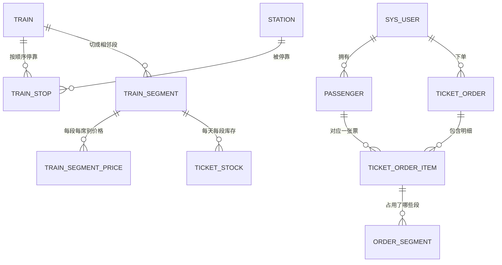
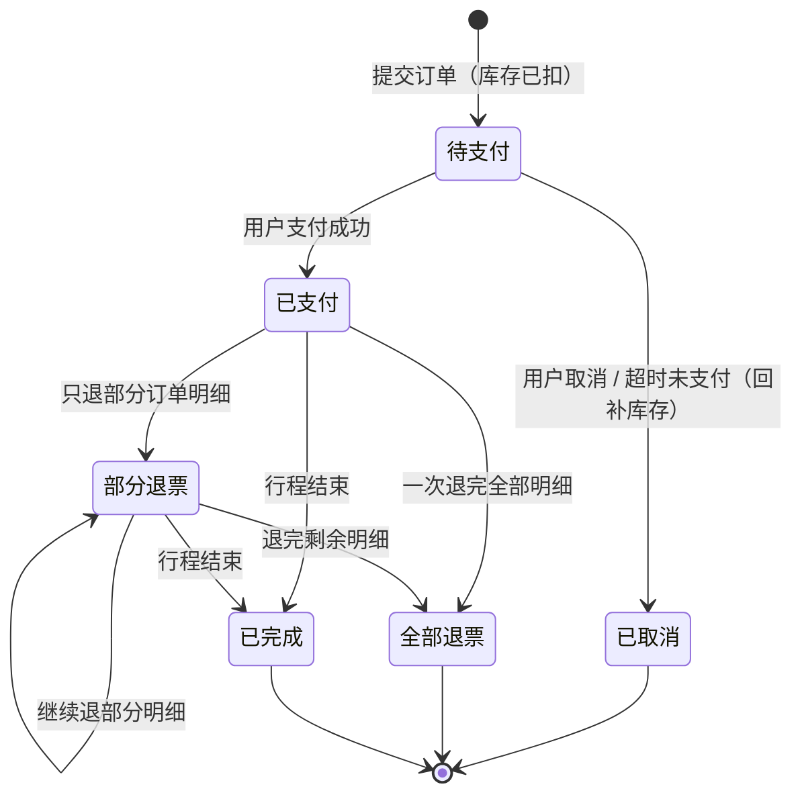

# 02 · 数据库设计

> 这份文档只讲一件事：**分段库存模型**。把它想通了，这个项目最难的 60% 就过去了。

> 可视化表关系：[交互网页](database-relations.html) ·
> [静态图片](database-relations.png)

---

## 一、一句话说清核心

一趟车沿途停 N 个站，就把它切成 **N-1 个「相邻站段」**。

票不是按「任意起点 → 任意终点」整段存的，而是**每一段各存一份余票**：

- 查 A → D 有没有票：看中间每一段的余票，取**最小值**
- 买 1 张 A → D：中间每一段**各减 1**
- 退 1 张 A → D：中间每一段**各加 1**

### 为什么不能按「任意两站」存？

如果直接存「北京南→上海虹桥 还有 3 张」「北京南→济南西 还有 8 张」这种所有起终点组合：

| 停站数 | 需要存的组合数 | 新增一个站要做什么 |
| --- | --- | --- |
| 5 站 | 10 条 | 要补 4 条新组合，还要重算原有数据 |
| 10 站 | 45 条 | 要补 9 条 |
| 20 站 | 190 条 | 要补 19 条 |

按相邻段存：

| 停站数 | 需要存的段数 | 新增一个站要做什么 |
| --- | --- | --- |
| 5 站 | 4 条 | 只加 1 条 |
| 20 站 | 19 条 | 只加 1 条 |

而且段模型天然表达了**座位复用**：一个座位在北京南→济南西 被占了，济南西→南京南 这一段还能卖给别人。
这就是现实中的高铁——你从北京南上车坐到济南西下车，你的座位在济南西之后就可以卖给别人。

---

## 二、用一个具体例子走一遍

演示车次 **G1001 北京南 → 上海虹桥**，停 5 个站，切成 4 段：

| 站序 | 车站 | 到达 | 发车 | 累计里程 |
| --- | --- | --- | --- | --- |
| 1 | 北京南 | — | 08:00 | 0 km |
| 2 | 济南西 | 09:22 | 09:24 | 406 km |
| 3 | 南京南 | 11:44 | 11:46 | 1023 km |
| 4 | 苏州北 | 12:57 | 12:59 | 1237 km |
| 5 | 上海虹桥 | 13:28 | — | 1318 km |

对应的 4 个段和票价（二等座）：

| 段号 | 区间 | 里程 | 二等座票价 | 当前余票 |
| --- | --- | --- | --- | --- |
| 1 | 北京南 → 济南西 | 406 km | ¥171 | 8 |
| 2 | 济南西 → 南京南 | 617 km | ¥259 | 3 |
| 3 | 南京南 → 苏州北 | 214 km | ¥90 | 6 |
| 4 | 苏州北 → 上海虹桥 | 81 km | ¥33 | 11 |

### 场景 1：有人查「北京南 → 上海虹桥」

覆盖段 1、2、3、4，取最小值：`min(8, 3, 6, 11) = 3`。

**结论：有 3 张票。** 瓶颈在第 2 段——虽然第 4 段还剩 11 张，但中间第 2 段只剩 3 张，
整条线最多只能卖 3 张。

### 场景 2：卖出去 2 张「北京南 → 南京南」

只覆盖段 1、2，两段各减 2：

| 段号 | 区间 | 余票 |
| --- | --- | --- |
| 1 | 北京南 → 济南西 | 8 → **6** |
| 2 | 济南西 → 南京南 | 3 → **1** |
| 3 | 南京南 → 苏州北 | 6 |
| 4 | 苏州北 → 上海虹桥 | 11 |

现在再查「北京南 → 上海虹桥」= `min(6, 1, 6, 11) = 1`。

注意：**没人买段 3、段 4，但全程票也跟着变少了**——因为要坐全程必须经过第 2 段。
这就是段模型自动算出来的，不需要额外逻辑。

### 场景 3：票价也是分段累加的

「北京南 → 南京南」二等座 = 段 1 + 段 2 = `171 + 259 = 430 元`。

真实高铁就是这么计价的，所以价格表也按段存，总价用 `SUM` 算出来，不用手工维护每一种组合的价格。

---

## 三、表关系总览



一句话概括：**基础数据（车站/车次/停站/段/价格）决定「能卖什么」，库存表决定「还有多少」，
订单表记录「谁买了什么」。**

---

## 四、表清单

| # | 表名 | 中文 | 作用 | 第几阶段用 |
| --- | --- | --- | --- | --- |
| 1 | `sys_user` | 用户端账号 | 乘客登录 | 阶段 2 |
| 2 | `sys_admin` | 管理端账号 | 管理员登录 | 阶段 2 |
| 3 | `passenger` | 乘车人 | 一个账号下多个乘车人 | 阶段 5 |
| 4 | `station` | 车站 | 北京南、上海虹桥…… | 阶段 3 |
| 5 | `train` | 车次 | G1001 是什么车 | 阶段 3 |
| 6 | `train_stop` | 停站 | 按顺序停哪些站 | 阶段 3 |
| 7 | `train_segment` | 分段 | 相邻两站一段 | 阶段 3 |
| 8 | `train_segment_price` | 分段票价 | 每段每席别多少钱 | 阶段 3 |
| 9 | `ticket_stock` | **分段库存** | 某天某车某段某席别还剩几张 | 阶段 4 |
| 10 | `ticket_order` | 订单 | 谁买了哪趟车 | 阶段 5 |
| 11 | `ticket_order_item` | 订单明细 | 一票一行 | 阶段 5 |
| 12 | `admin_operation_log` | 操作日志 | 管理员干了什么 | 阶段 6 |

完整建表语句见 [`sql/01-schema.sql`](../sql/01-schema.sql)。

---

## 五、重点表逐张说明

### `station` 车站

关键字段：`station_code`（三字码，唯一）、`station_name`、`city`、`pinyin_abbr`。

为什么要 `city`？因为用户在 12306 上输入的是「北京 → 上海」这种城市，不是具体车站。
查询时先按城市查出所有站：`北京` → 北京南、北京西、北京丰台……

### `train` 车次

关键字段：`train_no`（G1001，唯一）、`train_type`（G/D/K/T/Z）、`start_station_id`、`end_station_id`。

**注意：这张表里没有日期。** 一趟车是天天开的，日期体现在库存表的 `travel_date` 上。
如果把日期塞进车次表，那每天都要复制一份车次数据，改一次时刻要改 365 天。

`start_station_id` / `end_station_id` 是冗余字段（可以从停站表推导出来），留着是为了列表展示方便，
这是**允许的冗余**——用一点点存储换查询便利，但要在代码里保证两者一致。

### `train_stop` 停站（分段的源头）

```sql
id, train_id, stop_order, station_id,
arrival_time, departure_time, day_offset, mileage, is_start, is_end
```

- `stop_order`：第几站，**从 1 开始**。这个顺序是分段的唯一依据。
- `arrival_time` / `departure_time`：始发站没有到达时刻、终到站没有发车时刻，所以允许 `NULL`。
- `day_offset`：跨天车次要它。比如 23:00 发车、次日 06:00 到，到达站的 `day_offset = 1`。
- `mileage`：从始发站算起的累计里程，用来算价格和显示。

约束 `UNIQUE (train_id, station_id)` 保证「一个车次里同一个车站只出现一次」，
这样按车站反查停站序号时结果唯一，查询逻辑才敢写死成「查出来正好两行」。

### `train_segment` 分段

```sql
id, train_id, segment_index, from_stop_order, to_stop_order,
from_station_id, to_station_id, mileage
```

第 k 段 = 第 k 站 → 第 k+1 站，所以 `from_stop_order = segment_index`、`to_stop_order = segment_index + 1`。

**为什么要把段单独存一张表，而不是每次查询时用停站表临时算？**
因为库存表要引用「第几段」，价格表也要引用「第几段」，有一个稳定的编号大家才好对账。
段定义是**静态数据**（配好停站就固定了），库存是**动态数据**（每天每段都有），两者分开。

### `train_segment_price` 分段票价

```sql
id, train_id, segment_index, seat_type, price
```

唯一键 `(train_id, segment_index, seat_type)`：一趟车的某一段的某个席别只有一个价格。

席别用数字枚举：`1 = 商务座`、`2 = 一等座`、`3 = 二等座`。
（真实项目会单独建一张 `seat_type` 字典表，教学阶段用枚举更简单，也可以在 Java 里定义成枚举类。）

### `ticket_stock` 分段库存 ★ 心脏

```sql
id, travel_date, train_id, segment_index, seat_type,
from_station_id, to_station_id,          -- 冗余，方便直接看数据
total_count, sold_count, remaining_count, version, updated_at
```

唯一键 `(travel_date, train_id, segment_index, seat_type)`：
**一天 + 一趟车 + 一段 + 一个席别 = 唯一一条库存记录**。

这就是你说的「日期 + 车次 + 前一站 + 后一站 + 剩余票数」，只不过「前一站后一站」用
`segment_index` 表示，同时冗余了 `from_station_id` / `to_station_id` 方便你直接看数据、写调试 SQL。

几个设计要点：

1. **`remaining_count` 是冗余的**，理论上 `= total_count - sold_count`。留冗余是为了查余票时不用做减法，
   也能加 `CHECK (remaining_count >= 0)` 这条数据库级兜底约束，防住代码写错导致的超卖。
2. **`version` 现在用不上，但先留着**。以后要上 Redis 或者做乐观锁、排查「这张票到底被谁改过」时会用到。
3. **`updated_at` 只更新，不加 `created_at`**，因为库存是批量生成的，生成时间没太大意义，
   我们更关心「最后一次变动是什么时候」。

### `ticket_order` + `ticket_order_item` 订单

一个订单 → 多条明细，因为**一次下单可以给多个乘车人买票**：

```text
订单 202610101200001（G1001 北京南→南京南 二等座 2 人 共 ¥860 待支付）
├── 明细 1：张三  二等座 ¥430
└── 明细 2：李四  二等座 ¥430
```

明细里存了 `passenger_name`、`id_card_no` 的**快照**。为什么不只存 `passenger_id`？
因为乘车人以后可能改名，但订单是历史凭证，必须显示当时买票时的姓名。
这是数据库设计里一个很重要的思想：**订单类数据要存快照，不要只存外键。**

`train_no` 在订单表里也是冗余快照：订单列表不用联表就能显示车次号。

### 为什么不再单独建 `order_segment`

当前业务中，一个订单只包含一趟车、一个统一区间和一个席别，订单主表的
`from_segment_index`、`to_segment_index` 已经完整表达了占用的分段范围。

如果以“每张票 × 每一段”展开存储，2 位乘客购买 4 段就会产生 8 条记录。
订单量增加后会造成大量重复数据、索引膨胀和写入放大，而这些信息完全可以从订单的
起止段区间推导出来。

因此退票时直接读取订单上的区间，并用：

```sql
segment_index BETWEEN from_segment_index AND to_segment_index
```

回补库存即可。只有以后支持每位乘客乘坐不同区间、分段换座或一张票拆成多个不连续区间时，
才需要把区间移动到订单明细，或者新增专门的区间表。

---

### `pay_log` 支付流水（支付幂等兜底）

订单表回答“买了什么”，`pay_log` 回答“钱扣了没有、扣了几次”。

关键字段与约束：

| 字段 | 作用 |
| --- | --- |
| `request_id` | 客户端幂等键，唯一索引 `uk_pay_request` |
| `external_txn_id` | 第三方支付流水号，唯一索引 `uk_pay_external`；异步回调重复到达时在这里去重 |
| `success_order_id` | 生成列：仅当 `status=1` 时等于 `order_id`，唯一索引 `uk_pay_success_order` 保证一个订单最多一条成功流水 |
| `status` | 0=处理中，1=成功，2=失败，3=已关闭 |

为什么不能只改 `ticket_order.status` 就完事：

1. 重复点击或网络重试会让用户看到失败，但钱可能已经扣了；
2. 没有流水就没有对账依据，出了问题无法回答“到底扣了几次”；
3. 支付渠道的异步回调可能重复到达，必须有唯一的外部流水号兜底。

完整支付流程见 `08-项目开发日志.md` 第 14 条。

## 六、库存什么时候生成？

库存不是建表时插进去的，而是**车次配好停站之后，由程序批量生成**。

阶段 4 要写的功能：管理端点「为未来 15 天生成库存」，伪代码：

```java
LocalDate today = LocalDate.now();
for (int day = 0; day < 15; day++) {
    LocalDate travelDate = today.plusDays(day);
    for (TrainSegment segment : segmentsOf(trainId)) {       // 有 4 段就循环 4 次
        for (SeatType seatType : SeatType.values()) {          // 商务/一等/二等 循环 3 次
            // 一天一车 4 段 × 3 席别 = 12 条
            stockMapper.insertIfAbsent(travelDate, trainId, segment.getSegmentIndex(),
                                       seatType, capacity);
        }
    }
}
```

**必须防重复生成**：用 `INSERT ... ON DUPLICATE KEY UPDATE id = id`（靠唯一键挡掉重复）
或者先查后插。推荐前者，一次 SQL 搞定。

> 真实 12306 的预售期是 15 天，所以只生成未来 15 天；
> 再写个每天凌晨的定时任务（`@Scheduled`）滚动生成第 15 天那天的库存就行了。

---

## 七、怎么查余票（三步 SQL）

### 第 1 步：找出停靠这两个站的车次，并拿到停站序号

用户输入「北京南 / 上海虹桥 / 2026-10-15」：

```sql
SELECT t.id AS train_id, t.train_no,
       ts_from.stop_order AS from_order,
       ts_to.stop_order   AS to_order
FROM train t
JOIN train_stop ts_from ON ts_from.train_id = t.id AND ts_from.station_id = :fromStationId
JOIN train_stop ts_to   ON ts_to.train_id   = t.id AND ts_to.station_id   = :toStationId
WHERE t.status = 1
  AND ts_from.stop_order < ts_to.stop_order;   -- 顺序不能反
```

`ts_from.stop_order < ts_to.stop_order` 这个条件很重要：它同时保证了「这趟车真的从出发站开往到达站」，
而不是反方向。

### 第 2 步：取区间内所有段余票的最小值

出发站序号是 `f`，到达站序号是 `t`，那么覆盖的段就是 `f` 到 `t-1`：

```sql
SELECT MIN(remaining_count) AS remain
FROM ticket_stock
WHERE travel_date    = :travelDate
  AND train_id       = :trainId
  AND seat_type      = :seatType
  AND segment_index BETWEEN :f AND :t - 1;
```

> 例：北京南（站序 1）→ 上海虹桥（站序 5），覆盖段 1~4，`MIN(8,3,6,11) = 3`。

### 第 3 步：算总价

```sql
SELECT SUM(price) AS total_price
FROM train_segment_price
WHERE train_id = :trainId
  AND seat_type = :seatType
  AND segment_index BETWEEN :f AND :t - 1;
```

### 列表查询：一次把余票和价格都查出来

真正做车次列表时，不能一个车次发一次 SQL（那就是 N+1 查询）。一次查完：

```sql
SELECT
    t.id                          AS train_id,
    t.train_no                    AS train_no,
    t.train_type                  AS train_type,
    ts_from.departure_time        AS depart_time,
    ts_to.arrival_time            AS arrive_time,
    (ts_to.day_offset - ts_from.day_offset) AS day_diff,
    ts_to.mileage - ts_from.mileage         AS mileage,
    MIN(st.remaining_count)       AS remain_count,
    SUM(p.price)                  AS total_price
FROM train t
JOIN train_stop ts_from ON ts_from.train_id = t.id AND ts_from.station_id IN (:fromStations)
JOIN train_stop ts_to   ON ts_to.train_id   = t.id AND ts_to.station_id   IN (:toStations)
JOIN train_segment g
       ON g.train_id = t.id
      AND g.segment_index BETWEEN ts_from.stop_order AND ts_to.stop_order - 1
JOIN ticket_stock st
       ON st.travel_date    = :travelDate
      AND st.train_id       = t.id
      AND st.segment_index  = g.segment_index
      AND st.seat_type      = :seatType
JOIN train_segment_price p
       ON p.train_id        = t.id
      AND p.segment_index   = g.segment_index
      AND p.seat_type       = :seatType
WHERE t.status = 1
  AND ts_from.stop_order < ts_to.stop_order
GROUP BY t.id, t.train_no, t.train_type, ts_from.departure_time, ts_to.arrival_time,
         ts_to.day_offset, ts_from.day_offset, ts_to.mileage, ts_from.mileage
ORDER BY ts_from.departure_time;
```

因为 `ticket_stock` 和 `train_segment_price` 在 `(train_id, segment_index, seat_type)` 上都是唯一的，
每段只会匹配到一行，所以 `MIN` 取余票、`SUM` 算价格都不会重复计算。
**这一条 SQL 是阶段 4 最核心的产出，值得反复看几遍。**

---

## 八、下单怎么防超卖

这是整个项目**技术上最值钱的一节**，也是面试最爱问的地方。

### 简单但错误的做法

```text
1. SELECT 查当前余票，发现还有 3 张
2. 判断 3 >= 1，可以买
3. UPDATE 把余票改成 2
```

两个人同时执行，都查到 3，都以为能买，最后卖出 2 张但库存只减了 1 —— **超卖**。

### 正确做法：事务 + 条件更新 + 校验影响行数

```sql
-- 覆盖的每一段都要扣
UPDATE ticket_stock
SET sold_count      = sold_count + :count,
    remaining_count = remaining_count - :count,
    version         = version + 1,
    updated_at      = NOW()
WHERE travel_date    = :travelDate
  AND train_id       = :trainId
  AND seat_type      = :seatType
  AND segment_index BETWEEN :fromIdx AND :toIdx
  AND remaining_count >= :count;      -- ★ 关键：把判断写进 WHERE
```

Java 里：

```java
@Transactional(rollbackFor = Exception.class)
public void createOrder(CreateOrderDTO dto) {
    // ... 校验、算价 ...

    int segmentCount = dto.getToSegmentIndex() - dto.getFromSegmentIndex() + 1;
    int affected = stockMapper.deduct(dto, segmentCount);   // 执行上面的 UPDATE

    if (affected != segmentCount) {
        // 说明至少有一段余票不够，InnoDB 会锁住这些行，
        // 别的事务在这里等待，等它提交后重新判断 remaining_count >= count 就不满足了
        throw new BizException(ResultCode.TICKET_NOT_ENOUGH);
    }

    // ... 写订单主表、写订单明细，任何一步失败整个事务回滚 ...
}
```

**为什么这样就安全了？**

1. `UPDATE ... WHERE remaining_count >= count` 是**原子的**：InnoDB 给这些行加排他锁，
   另一个事务要改同一行必须等它提交。
2. `remaining_count >= count` 这个判断是在**锁内**执行的，等第一个事务提交后余票已经变少，
   第二个事务的条件就不成立了，`affected` 会是 0，于是抛异常回滚。
3. `CHECK (remaining_count >= 0)` 是数据库层的最后一道兜底，代码写错了也不会出现负数库存。

**注意点**：一个订单要扣多段，如果不同事务加锁顺序不一致，可能死锁。
解决办法是 `ORDER BY segment_index` 保证所有事务都按同样的顺序加锁，或者用 `IN (...)` 让
MySQL 自己排序。这个坑等你在阶段 5 压测时大概率会遇到，遇到了再去理解会更深刻。

---

## 九、取消订单 / 退票怎么回补库存

```sql
-- 订单主表保存了统一区间，所有乘客继承这个区间
SELECT from_segment_index, to_segment_index
FROM ticket_order
WHERE order_no = :orderNo;

-- 按起止段一次性回补区间库存（带上限保护，防止重复退票把余票刷成 999）
UPDATE ticket_stock
SET sold_count      = sold_count - :count,
    remaining_count = LEAST(remaining_count + :count, total_count),
    version         = version + 1
WHERE travel_date   = :travelDate
  AND train_id      = :trainId
  AND seat_type     = :seatType
  AND segment_index BETWEEN :fromSegmentIndex AND :toSegmentIndex;
```

超时未支付的订单怎么处理？订单表里有 `expire_time`，写个定时任务每分钟扫一次：

```sql
SELECT * FROM ticket_order
WHERE status = 0 AND expire_time < NOW();
```

把这些订单改成「已取消」，然后按上面的逻辑回补库存。**这就是为什么订单要先锁库存、再等支付**——
不锁的话会出现「两个人抢最后一张票，都去支付，一个成功一个失败」的尴尬。

---

## 十、订单状态机

状态必须**单向流转**，不能乱改：



订单状态：

```text
0 = 待支付
1 = 已支付
2 = 已取消
3 = 部分退票
4 = 全部退票
5 = 已完成
```

订单明细状态：

```text
0 = 有效待出票
1 = 已出票
2 = 已退票
```

“已出票”属于每一张票，不再作为整个订单的状态。订单主表通过
`refunded_count`、`refunded_amount` 和 `last_refunded_at` 汇总退款情况，
每张明细通过 `refunded_at` 记录自己的退票时间。

代码里要写一个校验方法，任何状态变更前先判断「当前状态 + 目标动作」是否合法：

```java
private void checkCanPay(TicketOrder order) {
    if (order.getStatus() != OrderStatus.PENDING_PAY) {
        throw new BizException(ResultCode.ORDER_STATUS_ERROR);
    }
    if (order.getExpireTime().isBefore(LocalDateTime.now())) {
        throw new BizException(ResultCode.ORDER_EXPIRED);
    }
}
```

---

## 十一、索引设计

| 表 | 索引 | 支撑什么查询 |
| --- | --- | --- |
| `station` | `uk(station_code)`、`idx(city)`、`idx(station_name)` | 按城市找站、按名字搜索 |
| `train` | `uk(train_no)` | 按车次号查 |
| `train_stop` | `uk(train_id, stop_order)`、`uk(train_id, station_id)` | 按车次看停站顺序；按车站反查站序 |
| `train_segment` | `uk(train_id, segment_index)` | 按车次取所有段 |
| `train_segment_price` | `uk(train_id, segment_index, seat_type)` | 取某段某席别价格 |
| `ticket_stock` | `uk(travel_date, train_id, segment_index, seat_type)`、`idx(travel_date, train_id, seat_type, segment_index)` | 查余票、扣库存 |
| `ticket_order` | `uk(order_no)`、`idx(user_id, created_at)`、`idx(travel_date, train_id)` | 我的订单、按车次统计 |

### 一个值得记住的细节：索引里字段的顺序

余票查询的条件是 `travel_date = ? AND train_id = ? AND seat_type = ? AND segment_index BETWEEN ? AND ?`，
前三个是等值、最后一个是范围。

`uk(travel_date, train_id, segment_index, seat_type)` 只能用到 `segment_index` 之前的等值条件，
因为**范围条件后面的字段没法再用索引定位**。
所以额外建了 `idx(travel_date, train_id, seat_type, segment_index)`，把等值字段全放前面，
范围字段放最后，索引才能一路用到底。

> 记住这个规律：**等值条件在前，范围条件在后。**

---

## 十二、分阶段建表，别一口气全建完

建议按阶段建，每个阶段只关心自己要用的表，理解会清楚很多：

| 阶段 | 建哪些表 |
| --- | --- |
| 2 | `sys_user`、`sys_admin` |
| 3 | `station`、`train`、`train_stop`、`train_segment`、`train_segment_price` |
| 4 | `ticket_stock` |
| 5 | `passenger`、`ticket_order`、`ticket_order_item` |
| 6 | `admin_operation_log` |

---

## 十三、为后期优化留的口子

现在不引入中间件，但表结构要给后面留好位置，免得重构：

1. **`ticket_stock.version`**：以后上乐观锁、或者排查「这条库存被谁改过」时有用。
2. **`ticket_order.expire_time`**：超时释放库存的前提。
3. **`ticket_order.status`**：状态机是整个订单模块的骨架，一开始就定义清楚，别后面加。
4. **所有表的 `created_at` / `updated_at`**：出问题时第一句话永远是「什么时候开始的」。
5. **进 Redis 的时候**：把「日期 + 车次 + 段 + 席别 → 余票」整个缓存进 Redis，
   扣减用 Lua 脚本保证原子性，数据库作为最终一致性的兜底。**表结构不用改**，
   因为 `ticket_stock` 的主键组合天然就是缓存 key。
6. **上消息队列的时候**：下单请求先进 MQ，后台慢慢消费落库，接口立刻返回「排队中」。
   订单表的 `status` 再加一个「排队中」状态即可。

**好的表结构，是那种加了中间件之后也不用改的表结构。**
