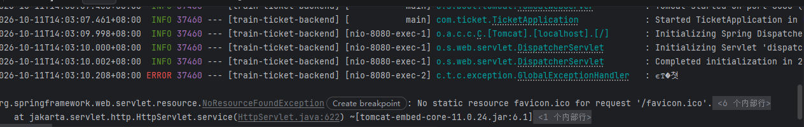

# 03 · 阶段 2 准备：接入数据库与 ORM 选型

> 回答四个问题：下一步是不是写调用数据库的接口、文件放哪、接口长什么样、
> 用 MyBatis 还是 MyBatis-Plus。

---

## 一、下一步是不是「写调用数据库的接口」

方向对，但严格说要拆成两小步，顺序不能反：

| 顺序 | 做什么 | 产出 |
| --- | --- | --- |
| 第 1 小步 | 把「连接」配好，用一个探针接口验证 | 能读到 `station` 表里的 5 个车站 |
| 第 2 小步 | 才是真正的业务接口 | 注册、登录 |

**为什么不能一上来就写注册接口？**

数据库连不上时，原因可能有两种：账号密码错，或者 ORM 配置写错。如果直接写注册接口，
报错了你分不清是哪一种，只能瞎猜。先用三行 SQL 的探针把「连接」单独验证掉，
出问题的范围就锁死了。

---

## 二、文件应该放在哪

以「注册接口」为例，一个业务接口正常拆成这几个文件：

| 职责 | 文件位置 |
| --- | --- |
| 收请求、返回结果 | `backend/src/main/java/com/ticket/module/auth/AuthController.java` |
| 业务逻辑、事务 | `.../module/auth/AuthService.java`、`.../auth/impl/AuthServiceImpl.java` |
| 跟数据库打交道 | `.../module/auth/mapper/SysUserMapper.java` |
| 对应 `sys_user` 表 | `.../module/auth/entity/SysUser.java` |
| 接收前端参数 | `.../module/auth/dto/RegisterDTO.java` |
| 返回给前端 | `.../module/auth/vo/UserVO.java` |
| 复杂 SQL 的 XML | `backend/src/main/resources/mapper/SysUserMapper.xml` |

而「配置连接」不新增文件，改的是已有的 `pom.xml` 和 `application.yml`；
探针接口放在 `module/health/` 下，和 `PingController` 作伴。

### 为什么 Entity 和 DTO / VO 要分开

因为接口字段和表字段的需求经常不一样：

- 表里存 `status = 1`，前端要显示「已支付」
- 注册接口绝不能把 `password` 返回给前端
- 表里没有「历时」这种字段，但车次列表要显示「5 小时 28 分」

混成一个类，迟早会不小心把密码返回出去。

---

## 三、一个接口写出来是什么样

以注册为例，一次请求会穿过这五层。

### 1. Controller：收参数、调 Service、包装返回

```java
@RestController
@RequestMapping("/api/user/auth")
public class AuthController {

    private final AuthService authService;

    public AuthController(AuthService authService) {
        this.authService = authService;
    }

    @PostMapping("/register")
    public R<Void> register(@RequestBody @Valid RegisterDTO dto) {
        authService.register(dto);
        return R.ok("注册成功，请登录", null);
    }
}
```

不写业务逻辑，不碰数据库，不写 try-catch。

### 2. Service：业务逻辑和事务都在这里

```java
@Service
public class AuthServiceImpl implements AuthService {

    private final SysUserMapper userMapper;
    private final PasswordEncoder passwordEncoder;   // BCrypt 加密器

    @Override
    @Transactional(rollbackFor = Exception.class)
    public void register(RegisterDTO dto) {
        if (userMapper.countByUsername(dto.getUsername()) > 0) {
            throw new BizException(ResultCode.USERNAME_EXISTS);
        }
        SysUser user = new SysUser();
        user.setUsername(dto.getUsername());
        user.setPassword(passwordEncoder.encode(dto.getPassword()));  // 绝不存明文
        user.setStatus(1);
        userMapper.insert(user);
    }
}
```

### 3. Mapper：只负责跟数据库说话

```java
@Mapper
public interface SysUserMapper {
    int countByUsername(@Param("username") String username);
    int insert(SysUser user);
}
```

一行业务判断都不写。

### 4. DTO：接收参数，校验规则写在字段上

```java
public class RegisterDTO {
    @NotBlank(message = "用户名不能为空")
    private String username;

    @NotBlank(message = "密码不能为空")
    @Size(min = 6, max = 20, message = "密码长度要在 6 到 20 位之间")
    private String password;
}
```

### 5. 整条链路

```text
浏览器 POST JSON
   → Controller 校验参数
   → Service 查重 + 加密
   → Mapper 执行 INSERT
   → 返回 R 结构
```

注意：Controller 和 Service 里一句 `try-catch` 都没有，出错直接 `throw`，
由阶段 1 写好的 `GlobalExceptionHandler` 统一转成
`{"code":1001,"msg":"用户名已存在"}`。这就是先搭骨架的好处。

> 用 `@Valid` 需要额外引入 `spring-boot-starter-validation` 依赖。

---

## 四、MyBatis 还是 MyBatis-Plus

**结论：不是二选一，MyBatis-Plus 是 MyBatis 的增强。**
学会 MyBatis，Plus 只是多了几个现成方法。

| 对比项 | MyBatis | MyBatis-Plus |
| --- | --- | --- |
| 是什么 | 半自动 ORM 框架 | 架在 MyBatis 上的工具库 |
| 单表增删改查 | 每张表都得自己写 SQL | 继承 `BaseMapper` 就自动有 |
| 复杂 SQL | 写在 XML 里 | 一样写 XML，Plus 不干涉 |
| 分页 | 自己写 `LIMIT` 或引 PageHelper | 自带分页插件 |
| 代码量 | 多 | 少很多 |
| 学习成本 | 要理解 XML 映射和 resultMap | 上手快，但多一层抽象 |

同样一件事，两边的写法：

```java
// MyBatis：先在 XML 里写一段 SQL，再在接口里声明方法
userMapper.selectById(1L);

// MyBatis-Plus：继承 BaseMapper，方法直接就有，不用写 SQL
userMapper.selectById(1L);
userMapper.selectCount(new LambdaQueryWrapper<SysUser>()
        .eq(SysUser::getUsername, "zhangsan"));
```

### 放到本项目上看

| 模块 | 用什么 | 原因 |
| --- | --- | --- |
| 车站 / 车次 / 停站 / 票价管理 | MyBatis-Plus | 全是单表增删改查，省掉大量重复 XML |
| 区间余票查询、条件扣减库存 | 手写 XML | 复杂 SQL，Plus 帮不上忙 |

所以最终形态是：**MyBatis-Plus 管单表，手写 XML 管复杂查询**，两样都会学到。

---

## 五、结论与建议

**ORM 选 MyBatis-Plus。** 国内项目主流，后面看教程、面试都更对口，
而且它是 MyBatis 的超集，不存在「学了 Plus 就不会 MyBatis」的问题。

两点要提前知道：

**第一，Spring Boot 版本偏新。** 本机是 Spring Boot 4.1.1，而 MyBatis-Plus 的 starter
主要是给 Spring Boot 3.x 写的，兼容性需要实测。如果不兼容，退路有三条：

1. 降到 Spring Boot 3.x（对学习反而更友好，网上教程 99% 都是 3.x 甚至 2.x）
2. 换回 `JdbcTemplate`（Spring 自带，零兼容风险）
3. 等兼容版本

**第二，「配数据源」和 ORM 的选择无关。** 不管最后用哪套，
`application.yml` 里的连接配置、`pom.xml` 里的 MySQL 驱动都是要加的。所以：

- 先用 `JdbcTemplate` 写三行 SQL 把连接验证掉
- 再用 MyBatis-Plus 写注册接口
