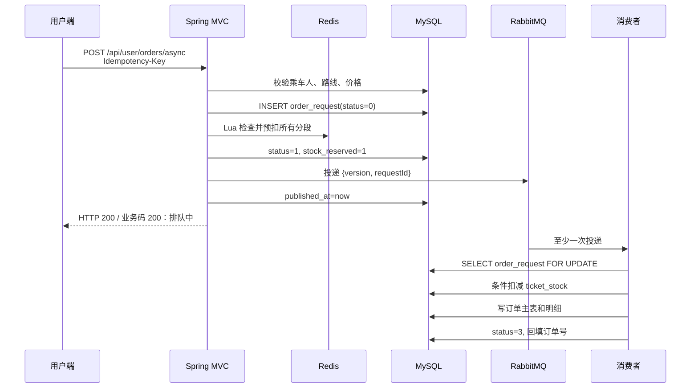

# 10 · Redis 与 RabbitMQ 异步下单

这份文档说明当前已经落地的完整链路。同步接口仍然保留，异步接口用于削峰，
两者最终都调用同一套 MySQL 订单落库逻辑。

## 1. 整体流程



MySQL 是最终事实来源。Redis 负责快速预扣，RabbitMQ 负责削峰，
两者都不能替代数据库事务。

## 2. 接口

提交：

```http
POST /api/user/orders/async
Authorization: Bearer <token>
Idempotency-Key: 5db5d60d-8ca0-45b1-b344-184ca4a4e772
Content-Type: application/json

{
  "trainId": 1,
  "travelDate": "2099-08-01",
  "fromStationId": 1,
  "toStationId": 5,
  "seatType": 3,
  "passengerIds": [1]
}
```

查询：

```http
GET /api/user/orders/async/5db5d60d-8ca0-45b1-b344-184ca4a4e772
Authorization: Bearer <token>
```

请求状态：

| status | 含义 | 是否终态 |
| --- | --- | --- |
| 0 | 已写请求，正在 Redis 预扣 | 否 |
| 1 | 已预扣，等待 RabbitMQ 消费 | 否 |
| 2 | 消费者处理中 | 否 |
| 3 | 下单成功 | 是 |
| 4 | 最终失败 | 是 |

成功响应中的 `orderNo` 可以直接用于原有订单详情、支付和退票接口。

## 3. Redis Key

```text
ticket:stock:{travelDate:trainId}:seatType:segmentIndex
```

示例：

```text
ticket:stock:{2099-08-01:1}:3:1
ticket:stock:{2099-08-01:1}:3:2
```

花括号内是 Redis Cluster Hash Tag。同一车次同一天的全部分段落在同一个 slot，
这样一段 Lua 才能一次操作多个 Key。

Value 是字符串形式的剩余票数，TTL 至少覆盖到乘车日期之后。
第一次预扣时从 MySQL `ticket_stock.remaining_count` 初始化。

Lua 逻辑：

```lua
for i = 1, #KEYS do
  if tonumber(redis.call('GET', KEYS[i])) < count then
    return 0
  end
end
for i = 1, #KEYS do
  redis.call('DECRBY', KEYS[i], count)
end
return 1
```

第一步只检查，第二步才扣减。任何一段不够都会直接返回，不会留下半扣状态。

## 4. RabbitMQ 拓扑

| 对象 | 名称 |
| --- | --- |
| 主 Exchange | `ticket.order.exchange` |
| 主 Queue | `ticket.order.create` |
| Routing Key | `ticket.order.create` |
| 死信 Exchange | `ticket.order.dlx` |
| 死信 Queue | `ticket.order.dead` |
| 死信 Routing Key | `ticket.order.dead` |

消息体只保存 requestId：

```json
{
  "version": 1,
  "requestId": "5db5d60d-8ca0-45b1-b344-184ca4a4e772"
}
```

完整业务参数以 `order_request.payload_json` 为准，避免消息体和数据库各存一份且版本不一致。

## 5. 幂等和重复消费

三层幂等：

1. `order_request.request_id` 唯一索引挡住重复提交。
2. 消费者对请求行执行 `SELECT ... FOR UPDATE`。
3. `ticket_order.order_no` 唯一索引作为最后兜底。

消费者发现请求已经是状态 3 或 4 时直接返回。
因此网络重试、RabbitMQ 重复投递、两个消费者并发收到同一消息，都不会重复建单。

## 6. 失败补偿

| 失败点 | 处理 |
| --- | --- |
| Redis 不可用或预扣不足 | 请求标记 4；不足时 Lua 不会扣任何段 |
| 已预扣，但 MQ 投递失败 | 标记 4，并按整段区间回补 Redis |
| 消费者 MySQL 业务失败 | 标记 4，回补 Redis |
| 应用在写请求后崩溃 | 恢复任务在超时后标记失败并修复数字库存 |
| 已写“待投递”，发 MQ 前崩溃 | `published_at IS NULL`，恢复任务重新投递 |
| 消息格式错误 | 拒绝并不重回原队列，RabbitMQ 路由到死信队列 |

支付、取消和退票仍走原有同步事务；数据库变化后会在事务提交后同步 Redis 数字库存。

## 7. 故障排查

查看队列：

```powershell
docker exec rabbitmq-ticket rabbitmqctl list_queues name messages_ready messages_unacknowledged consumers
```

查看某天某车 Redis 库存：

```powershell
docker exec redis-ticket redis-cli --scan --pattern "ticket:stock:{2099-08-01:1}:*"
```

查询请求状态：

```sql
SELECT request_id, status, stock_reserved, published_at,
       order_no, fail_reason, updated_at
FROM order_request
WHERE request_id = '替换成真实值';
```

死信队列中的消息不会自动重放。应先查 `order_request.fail_reason` 和 `backend/logs/mq.log`，
修复原因后再决定是否人工重新投递。
